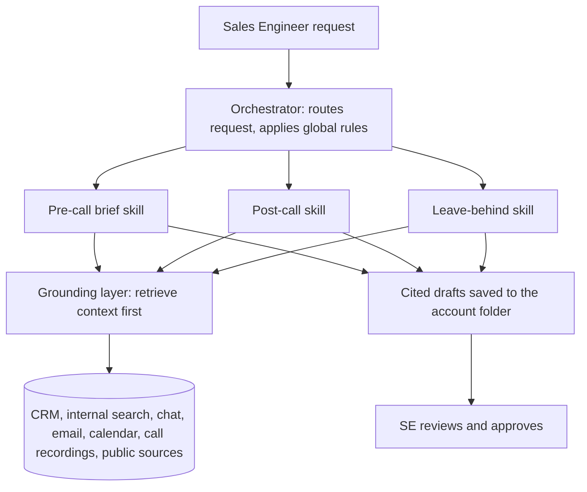

# SE Copilot: an AI agent for Sales Engineers

> **AI / LLM agent project** built during my Sales Engineering internship at Rubrik (Mid-Market Americas team, Summer 2026).
> This repository is a **project write-up**. The source code, prompts, internal tools, and customer data belong to Rubrik and are **not** included.

## What it is

SE Copilot is an AI agent that takes over the repetitive preparation and wrap-up work around customer calls for Sales Engineers (SEs). An SE asks for what they need, and the agent gathers grounded context from the team's systems and returns **cited drafts** that the SE reviews and approves.

## The problem

From shadowing 20+ customer calls across 8+ industries and holding 25+ one-on-one conversations with SEs and leaders, one pattern was consistent:

- **Before a call:** 30 to 45 minutes gathering account history, support cases, stakeholders, internal threads, and company news.
- **After a call:** 20 to 30 minutes writing the CRM note, drafting a follow-up email, and tracking commitments.
- The information already existed, but it was scattered across five or six systems, and prep quality varied with how much time an SE had.

## What I built

An LLM agent with a thin **orchestrator** that interprets a request and routes it to one of a few focused **skills**:

| Skill | What it does |
|---|---|
| **Pre-call brief** | Produces a cited account brief in a quick or full mode, or reuses a recent brief. |
| **Post-call package** | From a meeting transcript and two short intake questions, drafts the SE note in the team's format, a shorter leadership version, a customer follow-up email, and a to-do list of commitments. |
| **Client leave-behind** *(in progress at the end of the internship)* | Builds a client-ready summary and an architecture diagram that never invents topology; anything unconfirmed is shown as an explicit gap. |

## Design decisions

1. **Compose, don't duplicate.** Where the team already had a trusted framework (for example a qualification mapper based on the MEDDPICC methodology), the agent calls that logic instead of re-implementing it.
2. **Spec first.** The agent is a thin orchestrator plus small, readable skills, so behavior is easy to review and change.
3. **Ground everything.** The agent retrieves context first and writes only from what was retrieved. Every claim traces to a source, and unknowns are shown as gaps, not invented. This follows retrieval-augmented generation and is meant to reduce hallucination.
4. **Human in the loop.** The agent **never writes to the CRM and never sends email**. Every output is a draft the SE approves.
5. **Cost-aware model use.** A smaller model compresses large research inputs by roughly half to two-thirds before a larger model writes the final draft.
6. **Written in the SE's voice.** A component learns from an SE's own sent mail and chat messages so drafts read like the SE, not a template.

## Evaluation

I built an **evaluation harness** that turns "this feels better" into a repeatable score:

- **Rule-based checks:** citations present, required sections included, no writes to the CRM.
- **Rubric-based judging:** voice, tailoring, and grounding, scored by a language model acting as a judge and checked against my own labels.
- **Measurements tracked:** dollar cost per run (from token counts and per-model pricing), wall-clock time saved against the manual baseline SEs reported, and output quality.

## Results

| Task | Before | After |
|---|---|---|
| Pre-call brief | 30 to 45 minutes | about 2 minutes of review (quick mode) |
| Post-call note and email | 20 to 30 minutes | a short review of a drafted package |
| Cost per run | n/a | roughly $1 to $3 |

- In active use by **5 to 6 SEs** on live accounts, with more onboarding.
- SEs reported that cited, uniform output made account handoffs and manager reviews easier.
- *The time and cost figures are engineering estimates cross-checked against SE feedback, not production telemetry.*
- I also produced an architecture and design document, an onboarding runbook, and the evaluation rubric the team can reuse.

## Related work

With Sales Operations, I built a **pipeline-health dashboard** that gives SE leadership a live, region-level view of pipeline risk, coverage, and gaps.

## Concepts and skills used

LLM agents and orchestration (reason-and-act pattern), retrieval-augmented generation, prompt and skill design, evaluation harness design (LLM-as-a-judge), cost modeling, data connectors across enterprise systems, and human-in-the-loop safety guardrails. Coursework behind it: data mining (CSE 572), data-driven optimization (DSE 506), and time series forecasting (IEE 579).

## Selected references

- Yao et al., "ReAct: Synergizing Reasoning and Acting in Language Models," ICLR 2023.
- Lewis et al., "Retrieval-Augmented Generation for Knowledge-Intensive NLP Tasks," NeurIPS 2020.
- Zheng et al., "Judging LLM-as-a-Judge with MT-Bench and Chatbot Arena," NeurIPS 2023.
- Ji et al., "Survey of Hallucination in Natural Language Generation," ACM Computing Surveys, 2023.

## Author

**Aishwarya Srivastava**, M.S. Data Science, Analytics and Engineering, Arizona State University.

## Confidentiality note

This write-up is intentionally general. It omits internal code, prompts, system names, screenshots, and customer information.
